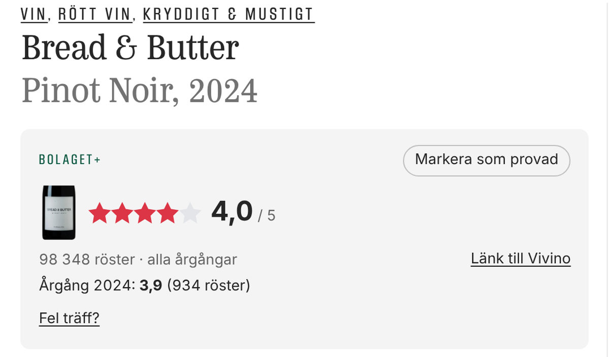
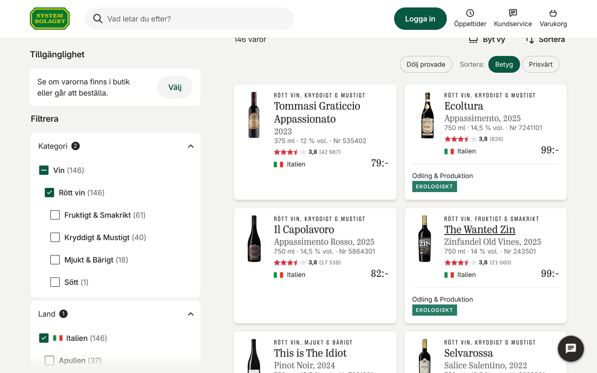
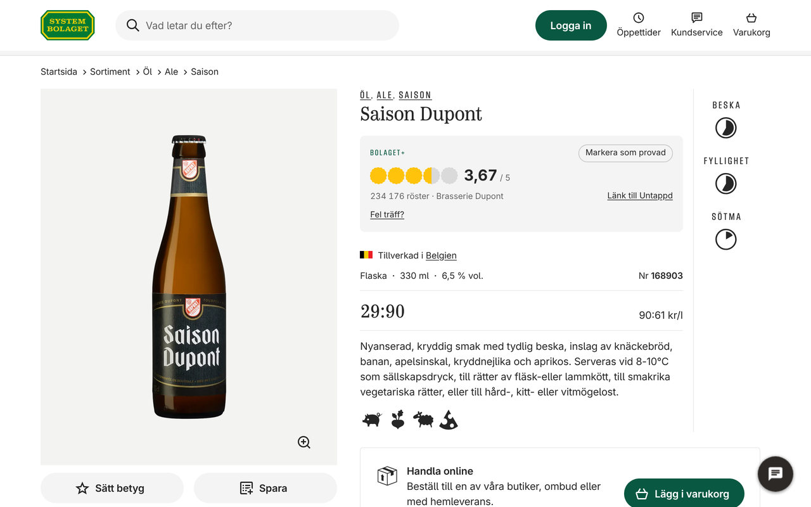
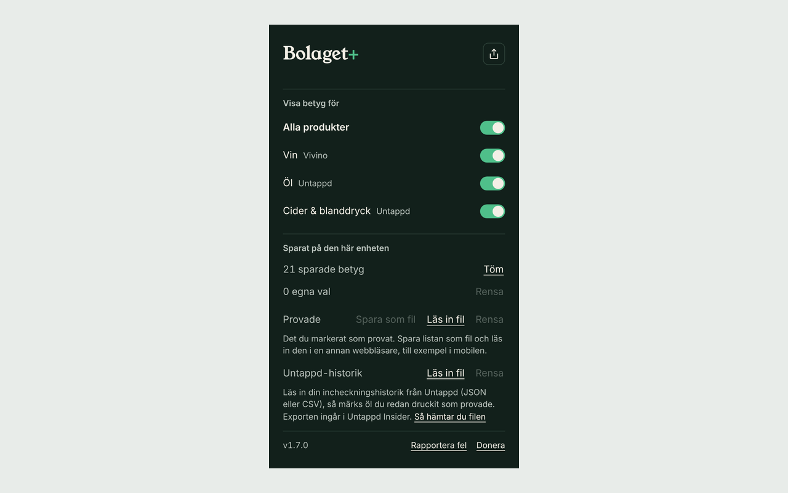

# Bolaget+

[](https://github.com/Johanneshn/bolaget-plus/releases) [](https://github.com/Johanneshn/bolaget-plus/actions/workflows/ci.yaml)

A browser extension that shows Vivino and Untappd ratings on
[Systembolaget.se](https://www.systembolaget.se): on product pages, and on the
cards in the product lists.



[](https://addons.mozilla.org/firefox/addon/bolaget-plus) [](https://chromewebstore.google.com/detail/bolaget-plus/bbjfkhmnofhindccdlfmhkibfafiogao)

## What it does

**On a product page** you get the rating, the number of votes and a link to
the wine on Vivino, or the beer or cider on Untappd. For wine it also shows the
rating of the vintage on the shelf when Vivino has one. Click the label
thumbnail to see it larger.

**In the product lists** the wines, beers and ciders it finds a match for get a
small rating badge. You can sort the cards you have loaded by rating, or by
*Prisvärt* — how much better a product is rated than is usual at its price.

**Tasted.** Mark a product as tasted and it is marked in the lists too, where
*Dölj provade* hides it. If you use Untappd Insider you can import your
check-in history, and beers you have already had are marked for you. The list
can be saved to a file and read into another browser.

**When the match is wrong.** Names on Systembolaget and on Vivino don't always
line up. When Bolaget+ isn't sure, it shows the closest candidates instead of
guessing, and *Fel träff?* lets you pick the right one; your choice is
remembered. Cards without a certain match link to a search on Vivino or
Untappd.

Wine ratings come from [Vivino](https://www.vivino.com/), beer and cider ratings
from [Untappd](https://untappd.com/). Each kind can be switched off in the
extension's popup.

**Rum and whisky** can be switched on there too: rum ratings come from
[RumX](https://rumx.com/) (out of 10), whisky ratings from
[Connosr](https://www.connosr.com/) (out of 100). Neither site has a search
the extension can use, so Bolaget+ matches the name against the site's list
of products and reads the one page it matched. Matching is strict: the age
and every word of Systembolaget's name must agree, and anything less certain
gets a search link instead of a rating. Switching either on asks your browser
for permission to read that site.

| Product lists | A beer | The popup |
|---|---|---|
|  |  |  |

## Privacy

Bolaget+ has no server and collects no personal data. To find a rating it
sends the name of the product you are viewing to Vivino's or Untappd's search,
the same search their own websites use. With rum or whisky switched on it also
reads RumX's or Connosr's list of products (at most once a week) and the page
of the product it matched. Ratings, your tasted list and your corrections are stored in your
browser. Nothing is sent to Systembolaget beyond what your browser already
loads when you visit the site.

## Install

Install from [Firefox Add-ons](https://addons.mozilla.org/firefox/addon/bolaget-plus)
or the [Chrome Web Store](https://chromewebstore.google.com/detail/bolaget-plus/bbjfkhmnofhindccdlfmhkibfafiogao).
Builds for both are also attached to each
[GitHub release](https://github.com/Johanneshn/bolaget-plus/releases).

Found a wrong rating or a bug? [Open an issue](https://github.com/Johanneshn/bolaget-plus/issues).

## Development

Built with [WXT](https://wxt.dev) and TypeScript. Install the dependencies with
[pnpm](https://pnpm.io/) (this also installs the git hooks):

```sh
pnpm install
pnpm dev:chrome    # or dev:firefox
```

The checks CI runs (fast, no network):

```sh
pnpm compile && pnpm ft:check && pnpm lint && pnpm test:unit && pnpm test:matching && pnpm build:chrome
```

Smoke tests run the built extension against the live Systembolaget, Vivino
and Untappd sites. They depend on those sites' markup, so they run nightly
rather than on every push:

```sh
pnpm test:smoke            # Chromium
pnpm test:smoke:firefox    # Firefox; set FIREFOX_PATH
```

Build with `pnpm build:chrome` or `pnpm build:firefox`; the output is in
`.output/`. [CLAUDE.md](CLAUDE.md) describes how the code fits together.

## License

[MIT](LICENSE)
